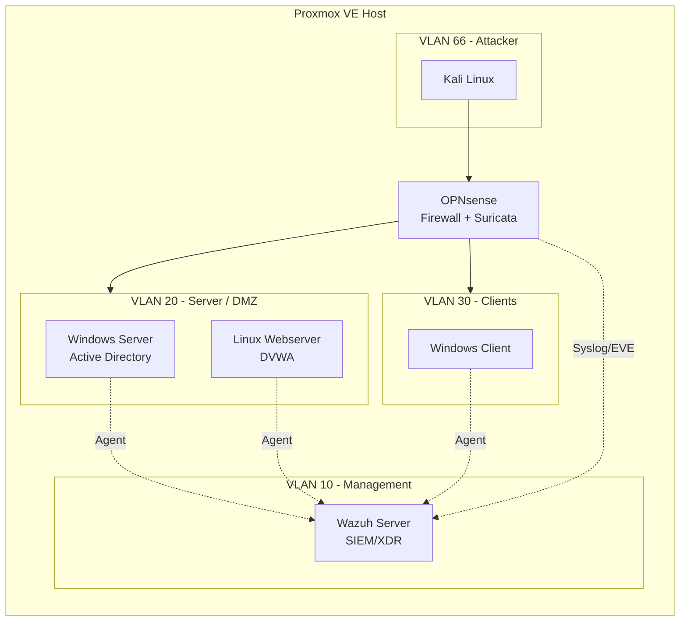

# Proxmox Blue Team Lab

Ein reproduzierbares **Mini-SOC-Homelab auf Proxmox VE**: segmentiertes Netzwerk, Wazuh als SIEM/XDR, Suricata auf der Firewall, simulierte Angriffe nach **MITRE ATT&CK** und eigene Detection-Regeln. Das Lab wird per **Terraform + Ansible** aufgebaut.

> Ziel: den kompletten Kreislauf zeigen – *Angriff → Logs → Detection → Alert → Incident-Report*.

## Architektur



Details: [docs/network-plan.md](docs/network-plan.md)

## Komponenten

| Rolle | System | Zweck |
|---|---|---|
| Hypervisor | Proxmox VE | Virtualisierung, Snapshots, Backups |
| Firewall / IDS | OPNsense + Suricata | Segmentierung, Netzwerk-Detection |
| SIEM / XDR | Wazuh | Log-Analyse, Alerting, Dashboards |
| Ziele | Windows Server (AD), Windows 10/11, Ubuntu + DVWA | Angriffsfläche |
| Angreifer | Kali Linux (optional Caldera / Atomic Red Team) | Angriffssimulation |

## Repo-Struktur

```
terraform/   VMs auf Proxmox anlegen (bpg/proxmox Provider)
ansible/     Wazuh Server/Agents ausrollen, Detections deployen
detections/  Wazuh-Regeln + Sigma-Regeln mit ATT&CK-Mapping
scenarios/   Angriff -> Detection -> Response (Playbooks)
reports/     Incident-Reports pro Szenario
docs/        Netzwerkplan, Hardening, Lab-Setup
```

## Quickstart

Voraussetzungen: Proxmox VE 8.x, API-Token, vorbereitete VM-Templates (siehe [docs/lab-setup.md](docs/lab-setup.md)), Terraform >= 1.6, Ansible >= 2.15.

```bash
# 1) VMs erstellen
cd terraform
cp terraform.tfvars.example terraform.tfvars   # Werte anpassen
terraform init && terraform apply

# 2) Wazuh + Agents + Detections ausrollen
cd ../ansible
cp inventory.example.ini inventory.ini         # IPs anpassen
ansible-playbook site.yml
```

## Detection-Abdeckung

| Szenario | ATT&CK | Regel | Status |
|---|---|---|---|
| [SSH Brute Force](scenarios/01-ssh-bruteforce.md) | T1110.001 | `detections/wazuh/local_rules.xml` (100110) | TODO: testen |
| [Kerberoasting](scenarios/02-kerberoasting.md) | T1558.003 | Wazuh 100100 + Sigma | TODO: testen |

*(Status nach jedem Test aktualisieren und Screenshots in die Reports legen.)*

## Hinweise

- Das Lab ist **isoliert** zu betreiben; Angriffssimulationen nur gegen die eigenen VMs.
- Keine Secrets committen: `terraform.tfvars` und `inventory.ini` stehen in der `.gitignore`.

## Lizenz

MIT
